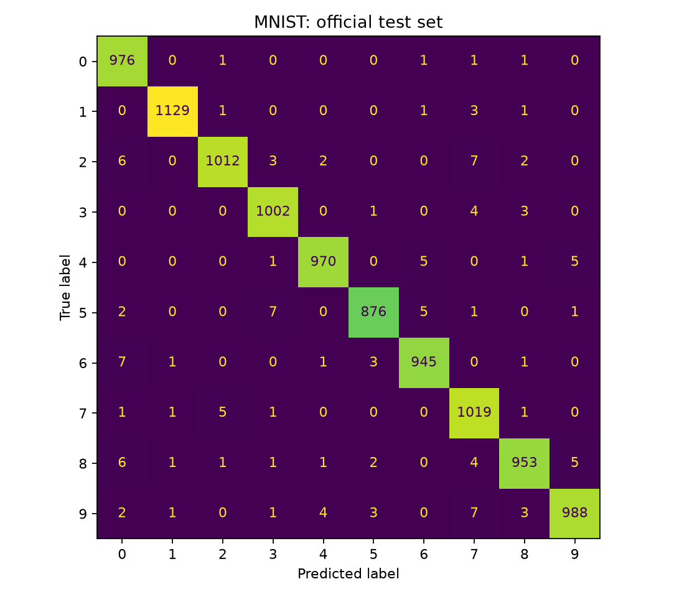

# Recorded experiment

See results/metrics.json for complete results.

```json
{
  "seed": 42,
  "train_samples": 54000,
  "validation_samples": 6000,
  "test_samples": 10000,
  "selected_epoch": 5,
  "selection_rule": "minimum validation loss",
  "test_accuracy": 0.987,
  "test_loss": 0.036333366598095745,
  "majority_baseline_test_accuracy": 0.1135,
  "dataset_url": "https://storage.googleapis.com/tensorflow/tf-keras-datasets/mnist.npz",
  "dataset_sha256": "731c5ac602752760c8e48fbffcf8c3b850d9dc2a2aedcf2cc48468fc17b673d1",
  "versions": {
    "torch": "2.14.1+cpu",
    "numpy": "2.5.4"
  }
}
```


